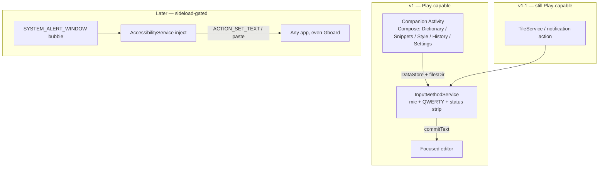
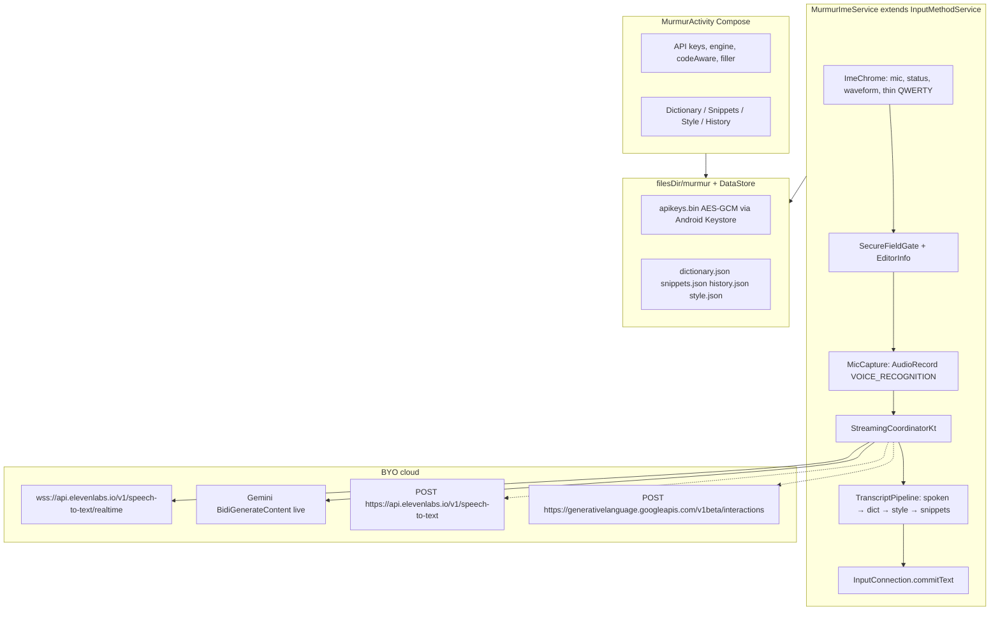
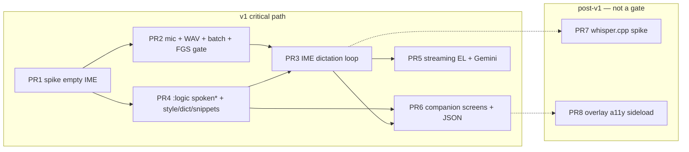

# Android Port of Murmur

| Field | Value |
|---|---|
| **Status** | Draft (rev 5, 2026-09-02 — owner answers locked) |
| **Author** | TBD (King Lollipop Studios) |
| **Date** | 2026-09-01 |
| **Plan number** | 029 (next unused after 028 Gemini; `plans/` is historical notes, not a roadmap — this document is not authorization to build) |
| **Does not authorize** | Play Store submit, Mac `project.yml` changes, iOS `project.yml` changes, Pro/IAP, Murmur-server, local Whisper on iOS, Accessibility-based global inject as v1 |

---

## Overview

Murmur is a push-to-talk dictation product. On Mac it is a menu-bar app that holds a HID tap, records, transcribes, and types into the focused app (`Sources/Voice/`). On iOS it is a custom keyboard plus containing app (`ios/`) that **cannot** own the microphone in the appex, so dictation bounces to the host. There is **zero Android code** in this repository today.

This document proposes an Android port as a **new platform product**, sibling of `ios/`, not a feature add to the Mac or iOS XcodeGen projects. v1 is **keyboard-first**: a custom `InputMethodService` that records audio while it is the current IME (tap-to-toggle on the mic; optional hold), transcribes via the same cloud providers already used on iOS (ElevenLabs Scribe v2 Realtime, Gemini 3.5 Transcribe Live, batch fallback), and inserts with `InputConnection.commitText` after the iOS post-process order. A companion Compose app owns Dictionary, Snippets, Style, History, Settings, and API keys. The IME service fail-closed promotes itself to a microphone FGS for the take.

Android v1 is **Play-capable** (IME + mic + internet; no Accessibility Service, no overlay required) but **sideload-only like iOS** (owner, 2026-09-02): ship GitHub APKs. Play listing is **not** a v1 deliverable. Overlay + Accessibility “type anywhere without switching keyboards” is a **later, sideload-gated** track — that is the Wispr Flow Android shape, and Play policy plus Android 17 Advanced Protection make it a hostile default. Local ASR (whisper.cpp) is a **separate ship-gated spike**, matching iOS’s explicit “no local Whisper” stance.

The Mac identifiers (`com.matt.voice-dictation`, Keychain `com.matt.voice-dictation.apikeys`, `~/Library/Application Support/Voice/`) stay Mac-only. Android gets its own applicationId, keystore alias, and files-dir names.

---

## Background & Motivation

### What exists today

**Mac (`Sources/Voice/`, module `Voice`, bundle ID `com.matt.voice-dictation`):**

Hold fn/Globe or Right Option → speak → release → transcript lands at the caret.

| Piece | Owner | Notes |
|---|---|---|
| Global PTT | `ActivationController` + `FnActivationLogic` | HID-level `CGEvent` tap (`.cghidEventTap`). Double-tap fn = toggle-lock (`FnActivationLogic.doubleTapWindow = 0.4s`). |
| Mic | `AudioRecorder` | `AVAudioEngine`. Sharp edges in `CLAUDE.md`: `prepare()` before `CurrentDevice` SIGABRTs; 0-ch Continuity graph; `engine.start()` posts `AVAudioEngineConfigurationChange`. |
| ASR protocol | `ASREngine.transcribe(audioURL:)` | Batch only. Streaming is a parallel path. |
| Streaming | `StreamingCoordinator` + `XAIStreamingTranscriber` / `ElevenLabsRealtimeTranscriber` / `GeminiLiveTranscriber` / `StreamingTranscriber` (WhisperKit) | Mic ownership stays in `AudioRecorder`; streamers consume PCM. |
| Local ASR | `WhisperKitEngine`, `ParakeetEngine` | CoreML / `parakeet-mlx`. **Apple-only.** |
| Cloud batch | `CloudTranscriber.swift` (`CloudTranscriptionService`) | xAI `https://api.x.ai/v1/stt`, plus retired providers still in the file. WAV via `CloudAudioTranscoder`. |
| Insert | `TextInjector` | CGEvent unicode first (does not touch pasteboard); clipboard+Cmd-V fallback with snapshot/restore. Accessibility required. Secure input: `IsSecureEventInputEnabled()` fail-closed (`TranscriptionPipeline.finishInjectGate`). |
| Post-process | `SpokenPunctuation`, `SpokenCapitalization`, `DotCompoundNumberNormalizer`, dictionary, snippets, `CleanupService` | Punctuation is Mac-only today. |
| Secrets | `KeychainStore` service `com.matt.voice-dictation.apikeys` | Do not reuse on Android. |
| Update | Sparkle | macOS-only. |

**iOS (`ios/`, App IDs `com.matt.murmur.ios` + `com.matt.murmur.ios.keyboard`, App Group `group.com.matt.murmur.ios`):**

Custom keyboard + Wispr-style shell. Floor iOS 27, iPhone only. **Not App Store-ready** (private host-return APIs).

Load-bearing facts from `ios/README.md` and `plans/README.md` §026:

- Keyboard appex **cannot** own the mic. `KeyboardViewController` opens `murmur://dictate` via `extensionContext.open`. Host `DictationController` + `MicRecorder` records. App Group `DictationHandoff` is polled every 80 ms; `textDocumentProxy.insertText` commits. Original in-appex record P0 **did not ship**.
- Cloud STT only: ElevenLabs Scribe v2 Realtime / Gemini 3.5 Transcribe Live; batch `scribe_v2` / `gemini-3.5-transcribe` fallback (`ios/Shared/ElevenLabsBatch.swift`, `ios/Shared/GeminiBatch.swift`). Local Whisper on iOS is **explicitly out of scope**.
- Secure fields: `textDocumentProxy.isSecureTextEntry` → phase `.secure`; `.done` insert is skipped (`KeyboardViewController.consumeHandoffIfReady`).
- Shared stores (`ios/Shared/DictionaryStore.swift`, `SnippetsStore`, `HistoryStore`, `StyleStore`, `StyleFormatter`, `TranscriptPostProcessor`) are Swift + App Group. **Not reusable on Android.**
- iOS `TranscriptPostProcessor.applySpokenPasses` runs capitalization then dot-compound numbers. Spoken punctuation stays Mac-only.
- Tokens: `ios/Shared/KeyboardChromeTokens.swift` and `ios/MurmurIOS/AppTheme.swift`. Do not import Mac `Sources/Voice/UI/Theme.swift` (AppKit).

**Repo constraint:** `grep` over product sources for `android`/`Android` is empty. Do not invent a shared Kotlin layer that already exists.

### Why Android now

1. iOS proved the mobile product is a **dictation-first keyboard + companion shell**, not a Mac HID tap in a smaller window.
2. Android is the one place this repo’s Linux cloud agents can actually **compile**. Mac and iOS cannot be built on the Linux VM (`AGENTS.md`). That is an operational win for unit-tested pure logic.
3. Competitors already shipped: Wispr Flow Android (2026-02-23) chose a **floating bubble + Accessibility**, explicitly *not* replacing the keyboard. Murmur iOS *is* a keyboard. Copying Wispr’s Android shape would fight both Play policy and Murmur’s iOS identity.

### Pain if we copy the wrong sibling

| If we copy Mac | If we copy iOS bounce | If we copy Wispr Android |
|---|---|---|
| No global fn HID tap. Accessibility inject is Play-hostile. Overlay HUD is a restricted setting. | Bounce is an Apple constraint. Android IMEs **can** record. Bounce would be a self-inflicted Messages-kidnapping class bug. | Overlay + Accessibility “type into Gboard’s field” is the product Wispr chose. Play Accessibility policy (Jan 2026) plus Android 17 Advanced Protection make it a listing risk. |

---

## Goals & Non-Goals

### Goals (v1)

- Ship a dictation-first Android IME that, while it is the current input method, can: tap (optional hold) mic → record → cloud transcribe → `commitText` into the focused editor.
- Companion app (Home / Dictionary / Snippets / Style / History / Settings / API keys), analogous to `ios/MurmurIOS/`.
- Reuse cloud **contracts** (ElevenLabs Scribe v2 RT, Gemini 3.5 Transcribe Live, batch fallback). Rewrite clients in Kotlin.
- Port pure post-process logic **tests-first**: spoken capitalization, spoken punctuation, dot-compound numbers, phrase-boundary matching, dictionary apply, snippet expand, style formatter, WAV 16 kHz/16-bit/mono writer, xAI stitch/dedupe if xAI ships in this track.
- Play-capable permission set. Sideload remains the honest default until the owner decides to list.
- `android/` sibling of `ios/`. Linux `./gradlew` unit tests + `assembleDebug`.

### Non-Goals (v1)

- Mac-like global inject via `AccessibilityService` / `ACTION_SET_TEXT` / overlay bubble.
- Local WhisperKit, Parakeet-MLX, FluidAudio speaker gating, Sparkle.
- Sharing Swift via Skip, Kotlin/Native, or a KMP module that wraps AppKit/AVFoundation.
- Adding Android targets to Mac `project.yml` or `ios/project.yml`.
- GitHub Actions CI (repo has **no CI by design** — owner confirmed 2026-09-02; do not add a workflow).
- Pro / subscription / IAP / Murmur-server (plan 025 is not Android authorization).
- Play Store listing as a v1 deliverable.
- Tablet / foldable / Wear / Automotive / Android TV.
- Cross-device dictionary sync with Mac/iOS.
- GIPHY / swipe-to-type / QWERTY daily-driver chrome bake-off (those are iOS 026/027). Android v1 keyboard chrome is **dictation-first**: mic + status + a thin QWERTY so the IME is usable when the user has switched to it. Full Gboard-class typing is later.

---

## Key Decisions

These are the load-bearing calls. Rationale is compressed here; the rest of the document expands them.

| # | Decision | Rationale |
|---|---|---|
| K1 | **v1 product = IME + companion app (keyboard-first).** Overlay/Accessibility global inject is later and sideload-gated. | Android IME **can** record while current. Official `InputMethodService` docs give an audio IME as a first-class example (the sentence is “listen to audio and perform **text to speech** conversion” — TTS wording, STT conclusion still holds). `commitText` is the honest analog of iOS `insertText`. Play Accessibility policy forbids pretending Murmur is an accessibility tool; Android 17 Advanced Protection can revoke non-tool a11y. Wispr Android is bubble-first (setup docs may also mention a keyboard *entry point*; that does not change the product). Murmur iOS *is* a keyboard. |
| K2 | **v1 is Play-capable code, sideload-only distribution (like iOS).** Ship GitHub APKs. Play listing is **not** a v1 deliverable. | **Owner confirmed 2026-09-02.** Keep the Play path clean (no Accessibility Service, no overlay required) so a later listing is cheap, not in-scope. Do not ship `BIND_ACCESSIBILITY_SERVICE` or require `SYSTEM_ALERT_WINDOW` in the default APK. |
| K3 | **Native Kotlin + Jetpack Compose (companion) + Views (IME) + Gradle.** Not KMP, not Flutter, not React Native. | Mac/iOS are native Swift. Nothing to share except HTTP/JSON/WS. Flutter/KMP would optimize for a Windows port that does not exist. Compose stays in the companion Activity. IME chrome is **Views-first** (K5). |
| K4 | **Cloud-only ASR in v1, matching iOS.** Engines: ElevenLabs Scribe v2 RT (default) and Gemini 3.5 Transcribe Live; batch fallback. xAI Grok STT is v1.1 if the Mac client is still the reference, not a v1 blocker. | WhisperKit / Parakeet-MLX are Apple-only. whisper.cpp is real but APK/RAM/Play-policy heavy. iOS already shipped cloud-only. |
| K5 | **One APK, default process.** IME service + settings activity in `:app`. No `:ime` process isolation in v1. IME chrome is **Views**, not Compose, unless a memory spike passes. | Standard Android IME packaging. **Not** because Keystore is process-scoped — Keystore and `filesDir` are **UID**-scoped; a `:ime` process of the same app can read the same alias. The real single-process constraint is Jetpack DataStore (not multi-process-safe unless MultiProcess DataStore / a ContentProvider). Costs of default process: OkHttp resident while typing; IME crash kills the companion and vice versa; OEM killers treat a fat IME worse. Keep the IME process thin: Views chrome, lazy OkHttp. |
| K6 | **`applicationId` = `com.matt.murmur.android`.** Files under `context.filesDir/murmur/`. Three names that must not be confused: (1) applicationId, (2) **Android Keystore key alias** `com.matt.murmur.android.apikeys` for the AES-GCM wrapping key, (3) the **APK signing** keystore — a local debug/release `.jks`, never the Mac Developer ID, never alias (2). | **Owner confirmed 2026-09-02.** Matches iOS `com.matt.murmur.ios`. Does not collide with Mac `com.matt.voice-dictation` or iOS App Group `group.com.matt.murmur.ios`. The APK-signing `.jks` is a later maintainer secret, not this string. |
| K7 | **minSdk 33 (Android 13), targetSdk 36 (Android 16), compileSdk 36. Phone-first. Do not bump target/compile to 37 in v1.** | **Owner confirmed 2026-09-02** (no concrete Android 12 user). POST_NOTIFICATIONS is API 33. `FOREGROUND_SERVICE_MICROPHONE` permission is API 34 — declare it; version-gate `startForeground(..., MICROPHONE)` (API 34+ type is mandatory; API 33 uses untyped `startForeground`). Stay on target/compile 36 until Play requires 37. Phone-first matches iOS `TARGETED_DEVICE_FAMILY: 1`. |
| K8 | **IME chrome follows system night mode; companion app is dark-first.** | Mac `Theme.swift` is dark-by-design. iOS keyboard follows `keyboardAppearance`. An Android IME that ignores the host’s light field looks broken in Gmail/Messages. Companion shell can be Murmur-dark like Mac. Own token file: `android/app/src/main/java/.../ui/MurmurTokens.kt`. Do not import AppKit Theme. |
| K9 | **Insert = `InputConnection.commitText` only after `preparedDictationInsert`.** Partials are HUD-only (never `setComposingText` for ASR). Skip dictation in password `inputType` **and** `autofillHints` password. No Accessibility inject in v1. Clipboard is a companion/scratchpad fallback only. | Analog of iOS `insertText` + `isSecureTextEntry` + `AutocorrectEngine.preparedDictationInsert`. Accessibility `ACTION_SET_TEXT` fails in WebView, games, and `FLAG_SECURE` surfaces and is Play-hostile. |
| K10 | **Activation v1 = tap-to-toggle on the IME mic (iOS analog).** Optional press-and-hold PTT (starts on `ACTION_DOWN` immediately — no 150 ms HID delay). Fail-closed: promote the IME to `FOREGROUND_SERVICE_TYPE_MICROPHONE` **on the start tap, while the input view is shown**. Current-IME is a generic FGS *background-start* exemption; it does **not** grant microphone WIU. Do not create a new microphone FGS in `onFinishInputView` after the window is gone — keep the already-started one. Tap-while-visible is the **supported** path; hide-while-recording is best-effort. If PR 2 IME+FGS gate fails on Pixel **and** Samsung, stop the v1 mic path and reopen K1 (do not bounce). | No global fn tap. Do **not** port `FnActivationLogic` wholesale (`resyncAfterTapReenable` / `reconcilePhysicalDownAfterRestart` are CGEvent-tap machines). Software mic: tap-to-toggle so the finger is not covering the status strip. Volume-key hold is OEM-hostile. QS tile is v1.1. Overlay bubble is later. |
| K11 | **HUD v1 = IME status/candidate strip waveform.** Notification when recording continues after hide. Overlay HUD later. | IME window is the legal, Play-safe surface. `SYSTEM_ALERT_WINDOW` is a special permission, restricted on sideload (Android 15 CDD), blocked on Android Go. |
| K12 | **Port spoken punctuation/caps/numbers as tests-first Kotlin. Pipeline order matches shipped iOS, not Mac inject order.** Spoken punctuation sits *inside* the spoken-passes step, gated by companion `codeAware` (Android default **on**). | iOS `DictationController` is `TranscriptPostProcessor` → `dictionary.correct` → `StyleFormatter.apply(..., preserveTerms:)` → `snippets.expand`. Mac `StyleProfile` is an LLM prompt; iOS/Android Style is local caps/punct. Snippets last so expansions are not restyled. Mac `codeAwareMode` UserDefaults default is **false**; Android defaults **on** so identifier joiners actually run — explicit product call, not a silent Mac copy. |
| K13 | **Secrets: in-repo AES-GCM wrapper over Android Keystore. Not EncryptedSharedPreferences. Not `datastore-tink` alpha for API keys.** Non-secret prefs (engine, language) may use ordinary DataStore. | `EncryptedSharedPreferences` is deprecated (androidx.security:security-crypto 1.1). `androidx.datastore:datastore-tink` (`AeadSerializer`) landed in DataStore 1.3.0-alpha07 (2026-04) and was still **alpha** as of 1.3.0-alpha10 (2026-07-29) — do not put production keys on an alpha serializer. Unique associated data = ciphertext filename. Tests use throwaway alias `com.matt.murmur.android.apikeys.TESTS` (`KeychainStore` destroyed a live xAI key on 2026-07-09). |
| K14 | **Live in this repo under `android/`.** Linux cloud agents run `./gradlew` by hand. **Do not add GitHub Actions.** | **Owner confirmed 2026-09-02.** Operational win vs Mac/iOS. CLAUDE.md / CONTRIBUTING.md “no CI by design” stands. |
| K15 | **Do not share Swift.** Rewrite audio, IME, UI, permissions. Extract cloud protocols as an internal note, then rewrite. | Skip / Kotlin-Swift interop is a science project against AppKit/AVFoundation. |

---

## Proposed Design

### 1. Product shape

Three Android shapes were on the table. v1 picks one; the others stay gated.



**v1 (recommended): keyboard-first, like Murmur iOS, unlike Wispr Android.**

User enables Murmur in Settings → System → Languages & input → On-screen keyboard, then switches to it in a field (globe / picker). Mic on the IME. **Tap mic to start, tap again to insert.** Optional press-and-hold is a Settings toggle, not the default loop. Companion app is where keys and dictionary live.

**Why this is honest about Play vs sideload**

| Surface | v1 | Play listing | Sideload |
|---|---|---|---|
| IME + RECORD_AUDIO + INTERNET | yes | allowed (IME is the user-visible justification) | allowed |
| FOREGROUND_SERVICE_MICROPHONE (whole take, fail-closed) | yes | allowed with FGS type + notification | allowed |
| POST_NOTIFICATIONS | yes (API 33+) | runtime prompt | runtime prompt |
| SYSTEM_ALERT_WINDOW | **no** | special permission; tapjacking history; not required for IME | Restricted Settings on Android 15+ sideload |
| BIND_ACCESSIBILITY_SERVICE | **no** | must declare; cannot set `isAccessibilityTool=true` honestly; Android 17 AAPM can block | Restricted Settings; malware-associated |

Wispr Flow Android (launched 2026-02-23) uses a floating bubble that appears over a focused field and does **not** replace the keyboard. Reviews and Wispr’s own help cite Accessibility + overlay/clipboard to detect fields and paste. Some Wispr setup pages also mention enabling a keyboard *entry point*; that does not change the product (bubble-first, Gboard stays). That is a valid product; it is not Murmur v1. Murmur already paid the “you have to switch keyboards” cost on iOS.

**Later (sideload-gated) global inject** is the Mac analog: speak into Slack while Gboard is still the IME. Do not build it in the same APK flavor as Play v1. If we ever want both, use a Gradle product flavor (`play` vs `sideload`) so Play review cannot see the a11y service.

**Foreground-service PTT from a notification / QS tile** is a reasonable v1.1 without Accessibility: the tile opens/starts dictation into the *current* IME connection if Murmur is the IME, otherwise it no-ops with a “switch to Murmur keyboard” toast. Volume-down hold is **not** v1: OEMs own volume, Accessibility volume intercept is the hostile path, and `AudioManager` does not give apps a global PTT key.

### 2. IME audio capture (verified against current docs)

**Claim:** an Android IME that is the current input method can record from the microphone. Whether that capture is legal **without** a microphone FGS is **unproven** on API 33–36 and is a PR 2 device gate, not a design assumption.

**Evidence (2026-09-01):**

- `InputMethodService` class docs (Android Developers): an implementor “could have no input area (and thus not be visible to the user) but instead listen to audio and perform **text to speech** conversion.” The sentence is TTS, not STT. The conclusion still holds: an audio IME is a first-class documented shape, unlike iOS appex.
- `Create an input method` guide: an IME is a `Service` subclass; only one IME is bound; the IME window is `TYPE_INPUT_METHOD`. There is often **no Activity**.
- Production prior art is mixed: LexiSharp / Hashtype / Sayboard / openIME record from `InputMethodService` with `RECORD_AUDIO`. whisperIMEplus declares `android:foregroundServiceType="microphone"` **on the `InputMethodService` itself**. Gboard voice typing is privileged. Do not treat third-party IMEs as proof that a visible IME window satisfies while-in-use without FGS on every OEM.
- Contrast with iOS: `UIInputViewController` is an appex with no mic entitlement that survives review. Android has no equivalent jetsam/mic ban for IMEs. That is the bounce contrast — not an FGS exemption.

**While-in-use / FGS (fail-closed):**

- `RECORD_AUDIO` is a while-in-use permission. Android 9+ only lets a visible Activity or a microphone FGS capture audio. An IME is a `Service` with an input-method window. **Do not ship assuming the window counts as Activity-class foreground.**
- **WIU vs current-IME exemption (do not collapse these):** [FGS background-start restrictions](https://developer.android.com/develop/background-work/services/fgs/restrictions-bg-start) list **current input method** as an exemption to *starting* a generic FGS from the background. The same page checks **microphone while-in-use separately**. Being the current IME does **not** grant microphone WIU and is not a license to call `startForeground(MICROPHONE)` after the input view is gone. Fail-closed `startForeground` must happen **while the input view is shown**, on the user tap that starts the take.
- **Fail-closed v1:** `MurmurImeService` promotes itself to `FOREGROUND_SERVICE_TYPE_MICROPHONE` for the **whole take** (while the IME is visible included), with a user-visible notification. If PR 2’s device gate shows Pixel **and** one aggressive OEM (Samsung) can capture from a visible IME with no FGS and no silence, we may drop the while-visible notification — that is a measured degrade, not the design of record.
- **PR 2 gate failure is a stop, not bounce:** if IME-visible + FGS-on-IME-service (gate 2) fails on **both** Pixel and Samsung, **stop the v1 mic path and reopen K1**. Do not bounce recording to the companion Activity (that is the iOS constraint we rejected). Overlay/a11y is still post-v1, not a silent fallback.
- Hide-while-recording (tap-to-toggle, user backs out of the field): keep the already-started microphone FGS; do **not** try to create a new microphone FGS in `onFinishInputView` after the window is gone. If `startForeground` was never reached while visible, log `fgs.start.denied` and stop capture — do not record silence. This path is **best-effort**; tap **while the IME is visible** is the supported path (OEM battery killers will murder FGS).
- Android 14+ (API 34): declare `android:foregroundServiceType="microphone"` on the IME `<service>`, permission `FOREGROUND_SERVICE_MICROPHONE`, and pass `FOREGROUND_SERVICE_TYPE_MICROPHONE` to `startForeground()`. Missing type → `SecurityException`.
- minSdk 33: `FOREGROUND_SERVICE_MICROPHONE` permission is API 34. Declare it in the manifest (ignored on 33). Version-gate the typed `startForeground` (`if (SDK_INT >= 34) startForeground(id, n, MICROPHONE) else startForeground(id, n)`).
- Do not start a microphone FGS from `BOOT_COMPLETED` or a killed process (Android 11+ while-in-use: FGS started from background cannot access the mic).
- Android 17 background-audio hardening (docs, last updated 2026-08-14, API 37) restricts **playback, audio focus, and volume** in the background. It is **not** a microphone-capture rule. Do not cite it as evidence for the mic FGS story. Extra WIU audio restrictions apply when *targeting* API 37 — v1 stays on target 36 (K7).

**Capture implementation**

- `AudioRecord` with `MediaRecorder.AudioSource.VOICE_RECOGNITION` (AOSP: expected AEC if present, no extra processing — correct for STT).
- 16 kHz, mono, `ENCODING_PCM_16BIT`, matching `ElevenLabsRealtimeTranscriber` / `GeminiLiveTranscriber` / `XAIStreamingTranscriber` (`AVAudioFormat` 16 kHz / 1 ch / pcmFormatInt16).
- Do **not** use `AudioSource.MIC` if `VOICE_RECOGNITION` is available; do **not** use `VOICE_COMMUNICATION` (it applies AEC/NS tuned for calls and is a “privacy-sensitive” source that wins audio focus fights).
- Write a rolling PCM ring plus an on-disk WAV for batch fallback (same split as Mac: streamers consume buffers; `CloudAudioTranscoder` / `WAVTranscoder` exist for the file path).
- Request audio focus (`AUDIOFOCUS_GAIN_TRANSIENT`) so Gboard/Assistant cannot silently steal the input; abandon on stop.

**Do not bounce to the companion app to record.** That is an iOS constraint (`KeyboardViewController` → `murmur://dictate` → `DictationController`). Copying it on Android reintroduces host-return bugs (`plans/README.md` §026 P0-host Messages default) for no gain.

### 3. Stack

```
android/                          # sibling of ios/; not in either XcodeGen project
  settings.gradle.kts
  gradle/libs.versions.toml
  logic/                          # JVM unit tests — Linux-safe
    src/main/kotlin/.../logic/
    src/test/kotlin/.../
  cloud/                          # OkHttp + WS; depends on :logic
  app/                            # applicationId com.matt.murmur.android
    src/main/java/.../            # IME (Views), Compose companion, AudioRecord, Keystore wrapper
    src/androidTest/              # instrumented IME tests (device)
```

- Language: Kotlin 2.x, coroutines, Flow. Pin in PR 1 `libs.versions.toml` (suggested: AGP 8.8.x, Kotlin 2.1.x, compileSdk/targetSdk 36, minSdk 33) so Linux `./gradlew` is reproducible. Do not “helpfully” bump compile/target to 37.
- UI: Jetpack Compose **only** for the companion Activity. IME input view is **Views-first** (`onCreateInputView` inflates XML / custom `View`s). Compose-in-IME is a later spike gated on (a) no OEM crash on Pixel + Samsung and (b) IME RSS after 10 minutes in Messages stays under a named budget (start at 80 MB; fail the spike if it does not). Do not pull in Flutter.
- HTTP/WS: OkHttp, created lazily on first dictate, not at IME inflate. Matches the “single sender queue, non-blocking capture thread” design in `XAIStreamingTranscriber` (capture thread yields frames; one coroutine drains onto the socket).
- DI: none required in the spike; Hilt is fine once `:app` has more than three objects. Do not introduce Koin+Hilt.
- Build: Gradle version catalog, `assembleDebug` unsigned, `assembleRelease` with a local **APK-signing** `.jks` (not the Mac Developer ID, not the Android Keystore key alias in K6).
- Process: default process (K5). If keys ever move to a `:ime` process, use MultiProcess DataStore or a bound provider — not “Keystore won’t work.”

**Why not Flutter / KMP / RN**

A future Windows port is hypothetical. Flutter’s IME story is a platform-view + MethodChannel to a Kotlin `InputMethodService` (Hashtype does exactly this). That is two UI toolkits and a slower keyboard process for **zero** shared UI with Mac/iOS (SwiftUI/AppKit). KMP could share `:logic` later if we rewrite Mac post-process in common Kotlin — that is a multi-year bet, not v1. `:logic` is already the extractable core; keep it pure Kotlin/JVM so a KMP move is a later rename, not a rewrite.

### 4. Architecture



**Pipeline order (match shipped iOS, not Mac inject)**

Mac `TranscriptionPipeline.preprocessBeforeCleanup` is caps → spoken punct (codeAware joiners) → numbers, then optional **LLM** cleanup (`StyleProfile.instruction` is prompt copy), then dictionary → snippets → `TextInjector`. iOS has no LLM cleanup. Shipped iOS (`ios/MurmurIOS/DictationController.swift` ~412–419):

```
TranscriptPostProcessor.applySpokenPasses(raw)   // caps then numbers; no punctuation
→ dictionary.correct
→ StyleFormatter.apply(..., preserveTerms: dictionary terms)
→ snippets.expand
```

Android v1 uses **that iOS order**, with Mac `SpokenPunctuation` inserted **inside** spoken-passes, gated by companion `codeAware` (default **on**):

| Step | Function | Notes |
|---|---|---|
| 1 | `SpokenCapitalization.apply` | Always. Same as Mac/iOS. |
| 2 | `SpokenPunctuation.apply(text, codeAware)` | `codeAware=true`: joiners + symbol table. `false`: sentence-end commands only (`exclamation point` → `!`). |
| 3 | `DotCompoundNumberNormalizer.apply` | Always. |
| 4 | `dictionary.correct` | Typed variants, iOS shape. |
| 5 | `StyleFormatter.apply(..., preserveTerms: dictionary terms)` | iOS local caps/punct, **not** Mac LLM. Snippets must not run yet. |
| 6 | `snippets.expand` | Last, so expansions are not restyled. |
| 7 | `preparedDictationInsert` + chunked `commitText` | Leading/trailing space. Partials never enter the field. |

**SpokenPunctuation SSOT** is `Tests/VoiceTests/SpokenPunctuationTests.swift`. `period` is a **word joiner** (`dot|period` between two `\w+` segments, `minWordLength: 1` in `Sources/Voice/SpokenPunctuation.swift`). It is **not** a trailing sentence command. Sentence-end commands are only `exclamation point` / `exclamation mark` / `question mark`. Do not invent `ship it period` → `ship it.`.

Spoken-passes fixtures (lock in `:logic`; must match those tests, not this table’s old wrong row):

| Raw after ASR | `codeAware` | After spoken-passes | SSOT |
|---|---|---|---|
| `foo period bar` | on | `foo.bar` | word joiner |
| `ship it period` | on or off | `ship it period` (no right-hand `\w+`; joiner does not fire; `period` is not in `phraseReplacements`) | do **not** map this to `.` |
| `ship it exclamation point` | off or on | `ship it!` | `testSentenceEndExclamationCommand` |

**Golden strings that diverge under snippet/style order** (lock these in `:logic` tests in PR 4, once StyleFormatter/dictionary/snippets pure functions are in `:logic`):

| Raw after ASR | Stores | Snippets-before-style (wrong) | iOS order (v1) |
|---|---|---|---|
| `thanks` | snippet `thanks` → `Thanks, Alex.` ; style VeryCasual | expand then lowercase/strip → `thanks, alex` | style then expand → `Thanks, Alex.` (expansion not restyled) |
| `ship it exclamation point` | style Casual, no snippet | `Ship it!` either way (Casual strips trailing `.` only, not `!`) | `Ship it!` |
| `foo underscore bar` | `codeAware=on`, style Formal, dict term `foo_bar` in `preserveTerms` | joiner `foo_bar`; Formal sentenceCase without preserveTerms becomes `Foo_bar` | `preserveTerms` keeps `foo_bar` |

Do not run Mac LLM cleanup. `codeAware` is a companion Settings toggle next to engine / keys / filler / language. Mac `SettingsStore.codeAwareMode` defaults **false** (`UserDefaults.bool`); Android defaults **on** so identifier joiners actually run.

Android v1 loop:

1. User taps mic (primary) or holds (optional). IME checks secure-field gate, then `RECORD_AUDIO`. If denied, start companion `MurmurPermissionActivity` (see §6); dictation no-ops until granted.
2. Promote IME to microphone FGS for the take (fail-closed). `MicCapture.start()`.
3. If streaming engine: open WS, send PCM frames (capture thread must not block on network — same invariant as `XAIStreamingTranscriber.send`).
4. Stop → re-run `isSecureDictationTarget` on the **current** `EditorInfo` (field may have changed mid-take). If secure or `InputConnection` changed, do not `commitText` and do not leave text on the clipboard. Else `finalize()`; if stream empty or truncated, batch WAV (`WavWriter` 16 kHz/16-bit/mono — port of `WAVTranscoder` / `CloudAudioTranscoder` contract, not the AVFoundation implementation).
5. Run the pipeline table above.
6. History append (`id/date/text/failed`, cap 200 — **iOS** shape). Never log transcript text (`VoiceLog` / `VOICE_DEBUG` invariant).
7. On IME unbind mid-stream: cancel the WS/batch coroutine unless hide-while-recording FGS is already up. Do not leak OkHttp calls.
8. Mid-take `onStartInput` / `onFinishInput` to a secure `EditorInfo`: stop capture immediately (same as step 4 skip), log `insert.secure_skip`. Do not wait for the user to tap stop.

Silence cancel: port `StreamingCoordinator.shouldTakeSilenceCancel` / `silenceCancelMaxBufferedSeconds = 0.5` as pure Kotlin with the existing tests’ semantics. Do not invent a new RMS threshold that reintroduces the 2026-08-31 empty-Gemini→WhisperKit cascade (there is no WhisperKit on Android v1; an empty stream must not hammer batch either).

### 5. Dictation sequence (v1 tap-to-toggle)

```mermaid
sequenceDiagram
  actor User
  participant IME as MurmurImeService
  participant Perm as MurmurPermissionActivity
  participant Mic as MicCapture
  participant WS as Cloud WS
  participant IC as InputConnection
  User->>IME: tap mic (primary)
  IME->>IME: EditorInfo password / autofillHints? abort
  alt RECORD_AUDIO denied
    IME->>Perm: startActivity FLAG_ACTIVITY_NEW_TASK
    Note over IME: status "Allow microphone in Murmur"; mic no-ops
    Perm-->>IME: grant result / next tap re-checks
  end
  IME->>IME: startForeground microphone (fail-closed)
  IME->>Mic: start VOICE_RECOGNITION 16 kHz mono
  IME->>WS: connect (xi-api-key / x-goog-api-key)
  WS-->>IME: session_started / setupComplete
  loop while recording
    Mic->>WS: PCM16 frame (non-blocking yield)
    WS-->>IME: partial_transcript
    IME->>IME: status strip only — never setComposingText
    opt onStartInput / onFinishInput to a secure EditorInfo
      IME->>IME: stop capture now; no commitText; no clipboard; insert.secure_skip
    end
  end
  User->>IME: tap mic (stop)
  IME->>IME: re-check EditorInfo secure / connection changed?
  alt now secure or connection changed
    IME->>IME: no commitText, no clipboard
  else
    IME->>WS: commit/finalize
    WS-->>IME: committed text
    IME->>IME: spoken → dict → style → snippets → preparedDictationInsert
    IME->>IC: commitText(chunks)
    IME->>IME: history.json append
  end
```

**Tap-to-toggle (primary):** first tap starts, second tap stops. The finger is not covering the waveform. This is the iOS mic analog, not Mac PTT.

**Optional press-and-hold:** Settings toggle. `ACTION_DOWN` starts capture **immediately** (do not wait 150 ms — that delay exists for HID fn tap-reenable). `ACTION_UP` / `ACTION_CANCEL` stops. `onFinishInputView` while held: treat as cancel unless hide-while-recording FGS already started.

**Hide-while-recording (best-effort, not the supported path):**

- The microphone FGS must already be running from the **start tap** (input view shown). On hide, **keep** that FGS; do not call `startForeground(MICROPHONE)` after the window is gone (current-IME exemption is not microphone WIU).
- If start never happened while visible: log `fgs.start.denied`, stop capture, toast.
- Notification: “Murmur is listening — tap to stop.”
- On stop: re-check secure-field / connection. If still bound to the same non-secure `InputConnection`, `commitText`; else no clipboard (do **not** Accessibility-paste).
- OEM battery killers make this unsupported; tap-while-visible is what we claim works.

Do **not** port `FnActivationLogic` as `ImeActivationLogic` with the Mac test table. `resyncAfterTapReenable` and `reconcilePhysicalDownAfterRestart` are CGEvent-tap machines. Extract at most `doubleTapWindow = 0.4s` if a later lock-button needs it. Write `ImeActivationLogic` against pointer events (`down` / `up` / `cancel`) plus `onFinishInputView` / `onWindowHidden`.

### 6. Text insertion

**Primary (v1):** `getCurrentInputConnection()?.commitText(prepared, 1)` after spacing + chunking.

This is the platform contract (`InputConnection.commitText`, API 3). It is the Android analog of iOS `textDocumentProxy.insertText` and is **not** the analog of Mac `TextInjector` (CGEvent). Do not try to synthesize `KeyEvent`s for Unicode; that path breaks on non-Latin and on many OEM editors.

**Partials are HUD-only.** Stream `partial_transcript` updates the status strip. Never `setComposingText` / `commitText` for ASR partials. The field changes once, on stop.

**Spacing — port iOS `AutocorrectEngine.preparedDictationInsert` (trailingSpace = true):**

- Trim the transcript.
- Leading space when `getTextBeforeCursor` (or `EditorInfo.initialSelStart` context) shows the caret follows a word character — tests in `AutocorrectEngineTests.testPreparedDictationInsertJoinsTakesWithoutGlue` (`hello there` + `more words` → ` more words `; no glue after an existing trailing space; no leading space after `(` or newline).
- Trailing space so the next take still separates if the host reports empty before-context.
- Then chunk like `AutocorrectEngine.bulkInsertChunks` (Messages-class hosts highlight the last chunk).

**IME cannot show the `RECORD_AUDIO` runtime dialog.** A Service is not an Activity. Contract:

| Piece | Spec |
|---|---|
| Component | `MurmurPermissionActivity` in the companion, action `com.matt.murmur.android.REQUEST_MIC` |
| Launch | IME `startActivity(intent.addFlags(FLAG_ACTIVITY_NEW_TASK))` when mic tapped and permission is denied |
| While waiting | Status “Allow microphone in Murmur”; dictation no-ops; QWERTY still types |
| After grant | Next mic tap re-checks `ContextCompat.checkSelfPermission`. Same Activity also requests `POST_NOTIFICATIONS` (API 33+) before the first FGS |
| Do not | call `requestPermissions` from the IME; do not bounce to record (that is iOS) |

**Secure fields — match iOS skip, not Mac clipboard-leave.**

```kotlin
fun EditorInfo.isSecureDictationTarget(): Boolean {
    val cls = inputType and InputType.TYPE_MASK_CLASS
    val varn = inputType and InputType.TYPE_MASK_VARIATION
    val passwordType = when (cls) {
        InputType.TYPE_CLASS_TEXT -> varn == InputType.TYPE_TEXT_VARIATION_PASSWORD
            || varn == InputType.TYPE_TEXT_VARIATION_WEB_PASSWORD
            || varn == InputType.TYPE_TEXT_VARIATION_VISIBLE_PASSWORD
        InputType.TYPE_CLASS_NUMBER -> varn == InputType.TYPE_NUMBER_VARIATION_PASSWORD
        else -> false
    }
    val hints = autofillHints?.any {
        it.equals(HintConstants.AUTOFILL_HINT_PASSWORD, true)
            || it.equals(HintConstants.AUTOFILL_HINT_NEW_PASSWORD, true)
    } == true
    return passwordType || hints
}
```

When true **at start:** IME shows a “Dictation off in password fields” status (iOS `.secure` phase). Do not record. Do not `commitText`. Do not copy to clipboard (Mac `shouldLeaveTranscriptOnClipboard` already refuses clipboard on secure input — same invariant). Log `inputType` hex + hint list, never field text.

**Abort as soon as the field becomes secure** (do not wait for stop). On `onStartInput` / `onFinishInput`, if the new `EditorInfo` is a secure dictation target, stop capture **immediately**, tear down the WS, skip `commitText`, skip clipboard, log `insert.secure_skip`. Otherwise BYO STT already has the audio. QWERTY still types.

**Re-check at stop before insert** remains a backstop (iOS `consumeHandoffIfReady` re-checks `isSecureTextEntry` on `.done`; Mac plan 016 is mid-hold secure-input). If the current `EditorInfo` is secure or the connection is no longer the one we started with: skip `commitText`, skip clipboard, log `insert.secure_skip`. Discard the take.

Also: `IME_FLAG_NO_PERSONALIZED_LEARNING` does **not** mean “no dictation”, but we should not write history from those fields. `TYPE_TEXT_VARIATION_FILTER` / PIN-ish number fields: still allow dictation of numbers unless the password variation or autofill hint is set.

**Accessibility inject (later, sideload):** `AccessibilityService` → focused node `ACTION_SET_TEXT` or clipboard + `performGlobalAction(GLOBAL_ACTION_PASTE)`. Known failures: WebView, SurfaceView/games, `FLAG_SECURE`, some Compose/Flutter hosts, work profiles. This is why it is not v1.

**Clipboard fallback (v1, companion only):** Scratchpad “copy”; failed insert while IME unbound after hide-while-recording. Snapshot/restore of the clipboard is Mac `TextInjector` complexity we do **not** take in v1 IME (the IME should not steal the user’s pasteboard). If we must paste, document it as a user-visible “copied — paste” toast.

### 7. Activation / PTT

Android has no analog of `ActivationController`’s `.cghidEventTap` on fn.

| Mechanism | v1 | Later | Notes |
|---|---|---|---|
| IME mic tap-to-toggle | **yes (primary)** | | iOS analog. First tap starts, second stops. |
| IME mic press-and-hold | optional setting | | Starts on `ACTION_DOWN` immediately. No 150 ms `holdThreshold`. |
| Hide-while-recording FGS | **yes, best-effort** | | Keep the FGS started on the start tap; do not `startForeground(MICROPHONE)` in `onFinishInputView`. Supported path is tap-while-visible. |
| Companion “Start dictation” | **yes** | | Only inserts if IME is current; else copies. Analog of iOS Action Button shortcut, without the bounce. |
| TileService | no | v1.1 | Quick Settings “Murmur”. Same gate: IME must be current. |
| Notification action | yes for hide-while-recording FGS | | Stop / cancel. |
| SYSTEM_ALERT_WINDOW bubble | no | sideload | Wispr Android shape. |
| Volume-down hold | no | maybe never | OEM media keys; Accessibility intercept is Play-hostile. |
| Bluetooth HID PTT | no | later | `KeyEvent.KEYCODE_HEADSETHOOK` while IME current. |
| RecognitionService (system voice input) | no | later | Lets other apps call `SpeechRecognizer`. Out of v1 scope. |

### 8. HUD

- **While IME visible:** status strip + RMS bars, analog of Mac `RecordingHUD` and iOS listening overlay. Keep it inside the IME window (cannot draw above the IME top on some OEMs; iOS 026 forbade drawing above the keyboard edge for the same reason).
- **Hide-while-recording:** FGS notification with stop action and a static “listening” indicator. Live waveform in a notification is API-fragile; do not promise it. Best-effort (K10).
- **Overlay HUD:** later, same flavor as the bubble.

Dark/light: IME chrome tokens follow `Configuration.UI_MODE_NIGHT_*` and `EditorInfo.IME_FLAG_NO_*` is irrelevant for color. Companion remains dark-first (`MurmurTokens` coral `#D85A30` / `#F0997B`, bg `#101014` for the shell — Mac `Theme.swift` numbers, redeclared in Kotlin, not imported).

### 9. ASR

#### Cloud (v1) — rewrite clients, keep contracts

Do **not** share Swift. Extract a protocol note (`android/docs/cloud-protocols.md`, written in the cloud-client PR) from the file headers that already document the wire format.

**ElevenLabs Scribe v2 Realtime** — source of truth: `Sources/Voice/ElevenLabsRealtimeTranscriber.swift` (also compiled into iOS host via `ios/project.yml`).

- URL: `wss://api.elevenlabs.io/v1/speech-to-text/realtime?model_id=scribe_v2_realtime&audio_format=pcm_16000&language_code=<lang>` plus `no_verbatim`, repeated `keyterms`, optional VAD/commit from `ElevenLabsRealtimeOptions`.
- Header: `xi-api-key` (not Bearer, not query).
- Audio: **text JSON** frames, not binary: `{"message_type":"input_audio_chunk","audio_base_64":"...","commit":bool,"sample_rate":16000}`. All four fields required.
- Ready gate: `session_started`. Partials: `partial_transcript`. Finals: `committed_transcript` (sequential, no stitch).
- Batch fallback: `ios/Shared/ElevenLabsBatch.swift` — `POST https://api.elevenlabs.io/v1/speech-to-text`, multipart, `model_id=scribe_v2`, `xi-api-key`, `no_verbatim`, repeated `keyterms`. WAV 16 kHz 16-bit mono (`WAVTranscoder.uploadMimeType = audio/wav`).

**Gemini 3.5 Transcribe Live** — `Sources/Voice/GeminiLiveTranscriber.swift`, `GeminiLiveOptions.swift`; batch `ios/Shared/GeminiBatch.swift`.

- Live: BidiGenerateContent WebSocket, PCM16 16 kHz, session cap `GeminiLiveTranscriber.sessionCapSeconds = 580`.
- Batch: `POST https://generativelanguage.googleapis.com/v1beta/interactions`, header `x-goog-api-key`, WAV base64 body from `GeminiLiveOptions.makeBatchRequestBody`. Plan 028 is SHIPPED in code; live handshake was unverified on Mac — Android should treat Gemini live as **device-gated**, same honesty.

**xAI Grok STT** — `Sources/Voice/XAIStreamingTranscriber.swift`, batch `CloudTranscriber.swift` `XAITranscriptionService` (`https://api.x.ai/v1/stt`).

- Live: `wss://api.x.ai/v1/stt?sample_rate=16000&encoding=pcm&interim_results=true&language=en&endpointing=5000`, `Authorization: Bearer`. **Binary** PCM frames. `audio.done` text frame to finalize. Chunk finals are segment-local → **stitch/word-overlap** (`XAIStreamingTranscriber.stitchWithWordOverlap`, tests in `StitchDedupeTests.swift`). Port those tests with the client.
- iOS does **not** ship xAI today (`SelectedCloudEngine` is elevenLabs | gemini). Android v1 can match iOS (EL + Gemini) and add xAI as soon as the stitch tests are green — not a v1 blocker.

**Default engine:** ElevenLabs, matching iOS `AppGroupStore.selectedCloudEngine` default `.elevenLabs`. Mac default is still local WhisperKit — that default does not apply.

**Out of v1 picker:** AssemblyAI, Deepgram, OpenAI, Groq remain in Mac `CloudProvider` / `CloudTranscriber` as retired-from-UI code (plan 013). Do not port them.

#### Local (not v1)

| Option | Size / RAM | Play | Recommendation |
|---|---|---|---|
| whisper.cpp JNI (`examples/whisper.android`) | tiny.en ~75 MiB disk / ~273 MB RAM; base.en ~142 / ~388; small ~466 / ~852. Quantized Q5 ~26–30 MB disk for base. | Large on-device ML is allowed; must disclose. 16 KB page-size native libs required on Android 15+. | **Spike, ship-gated.** Closest to WhisperKit semantically. Do not bundle a model in the APK (Play size + 16 KB). First-run download to `filesDir/murmur/models/`. |
| Sherpa-ONNX | Similar; strong CJK community (openIME). | Same. | Not the default spike; Murmur is English-first. |
| Google `SpeechRecognizer` / on-device | 0 extra APK. Quality and language pack are OEM/GMS. | Fine. | Not the product. We cannot BYO-key, cannot send `keyterms`, cannot match Scribe. Optional “system recognizer” fallback is a later accessibility courtesy, not v1. |
| Gemini Nano / ML Kit GenAI | Pixel-class, experimental. | Fine. | Cleanup candidate later, not ASR v1. |

v1 ships **without** a local engine. Empty cloud key → onboarding “add a key”, same as iOS `.setup` (keys still type; mic dead).

### 10. Feature parity matrix

| Feature | Mac | iOS | Android v1 | Later |
|---|---|---|---|---|
| PTT | HID fn / Right Option | Keyboard mic (bounce) | IME tap-to-toggle (optional hold) | QS tile, bubble |
| Toggle-lock / stay-on | Double-tap fn | tap mic (already toggle) | tap-to-toggle; FGS if IME hides mid-take (best-effort) | |
| Live HUD | `RecordingHUD` | Listening overlay / Live Activity | IME status strip | Overlay |
| Local ASR | WhisperKit default, Parakeet sidecar | **Out of scope** | **Out of scope** | whisper.cpp spike |
| ElevenLabs Scribe v2 RT | yes | yes | **yes (default)** | |
| Gemini 3.5 Transcribe Live | yes | yes | **yes** | |
| xAI Grok STT | yes | no | optional, not blocker | yes |
| Batch fallback | yes | yes | **yes** | |
| Cleanup (Apple Intelligence) | on-device FM | no | **no analog** | Gemini Nano / cloud LLM |
| Cleanup cloud LLM | OpenAI / xAI | no | later | yes |
| Style (local caps/punct) | yes | `StyleFormatter` | **yes (port)** | |
| Dictionary | yes + phonetic learn | typed variants | **typed variants (iOS shape)** | phonetic learn |
| Snippets | yes | yes | **yes** | |
| History | yes | yes (200) | **yes** | |
| Insights / WPM | Mac (plan 006 partial) | no | no | maybe |
| Transforms | Mac | no | no | maybe |
| Speaker gating | FluidAudio spike | no | no | no (Apple/CoreML) |
| Sparkle | yes | n/a | **no** | Play in-app updates if listed; GitHub releases if not |
| Onboarding | permissions + model | Full Access + key + enable keyboard | enable IME + mic + key | |
| Key storage | Keychain | App Group UserDefaults *(iOS stores keys in suite — weaker than Mac)* | **Keystore AES-GCM file (K13)** | |
| Recordings retention | `RecordingRetention` 200 MB default | ephemeral CAF in App Group | optional; default off in v1 (cloud stream is primary) | Mac-like retry library |
| Spoken capitalization | yes | yes (`TranscriptPostProcessor`) | **yes** | |
| Spoken punctuation | yes | **Mac-only today** | **yes, inside spoken-passes, `codeAware` gated** | |
| Dot-compound numbers | yes | yes | **yes** | |
| Code-aware | cleanup + spoken punct (default **off**) | no AI cleanup | spoken punct joiners; default **on**; no LLM | cloud cleanup |
| Secure field skip | `IsSecureEventInputEnabled` | `isSecureTextEntry` | `TYPE_*_PASSWORD` **and** autofill password hints | |
| Insert spacing | Mac `smartLeadingSpace` | `preparedDictationInsert` trailingSpace | **iOS insert helper** | |
| QWERTY daily driver | n/a | yes (027 chrome) | thin QWERTY so IME is usable | Gboard-class later |
| GIF / swipe | n/a | yes (swipe ship-gated) | no | no unless asked |

### 11. Repo layout

```
android/                    # NEW. Sibling of ios/. Not referenced by either project.yml.
  README.md                 # setup, verify, Play vs sideload honesty (only if/when code lands)
  gradle/libs.versions.toml
  settings.gradle.kts
  logic/                    # pure Kotlin, JUnit on JVM
  cloud/                    # OkHttp clients, depends on :logic
  app/
    src/main/AndroidManifest.xml
    src/main/java/com/matt/murmur/android/
      ime/MurmurImeService.kt
      ime/ImeChrome.kt            # Views, not Compose
      ime/ImeActivationLogic.kt   # pointer down/up/cancel; not FnActivationLogic
      capture/MicCapture.kt
      pipeline/TranscriptPipeline.kt
      store/MurmurStores.kt
      crypto/ApiKeyStore.kt       # Keystore AES-GCM; tests use …apikeys.TESTS
      perm/MurmurPermissionActivity.kt
      ui/   # Compose companion only
    src/main/res/xml/method.xml   # subtype en-US, supportsSwitchingToNextInputMethod=true
    src/androidTest/
  docs/cloud-protocols.md   # written with the first cloud client PR
```

**applicationId:** `com.matt.murmur.android`  
**IME service:** `com.matt.murmur.android.ime.MurmurImeService` (same APK)  
**Do not** register `com.matt.murmur.ios.*` or `com.matt.voice-dictation.*`.

Linux cloud agents (`AGENTS.md`): **can** run

```bash
cd android && ./gradlew :logic:test :cloud:test :app:assembleDebug
```

That is a real verify path this repo does not have for Mac/iOS. **No GitHub Actions** (owner confirmed 2026-09-02). CLAUDE.md / CONTRIBUTING.md “no CI by design” stands.

### 12. What is portable vs rewrite

**Port as logic + tests (Kotlin, JVM):**

| Swift | Tests to carry | Kotlin home |
|---|---|---|
| `SpokenPunctuation` | `SpokenPunctuationTests` | `:logic` |
| `SpokenCapitalization` | `SpokenCapitalizationTests` | `:logic` |
| `DotCompoundNumberNormalizer` | `DotCompoundNumberNormalizerTests` | `:logic` |
| `PhraseBoundaryPattern` | `PhraseBoundaryTests` | `:logic` |
| Dictionary apply + variant regex | `DictionaryLearnTests` (apply subset), iOS `DictionarySnippetsTests` | `:logic` **PR 4** |
| Snippet expand | iOS `DictionarySnippetsTests` | `:logic` **PR 4** |
| `StyleFormatter` + `StyleProfile` | iOS `StyleFormatterTests` | `:logic` **PR 4** (screens persist JSON in PR 6) |
| `XAIStreamingTranscriber.stitchWithWordOverlap` | `StitchDedupeTests` | `:cloud` or `:logic` |
| `StreamingCoordinator.shouldTakeSilenceCancel` | `StreamingSilenceBypassTests` (pure cases) | `:logic` |
| `CloudTranscriptionError.redactedBodyFragment` | `RedactionTests` | `:cloud` |
| Pointer-event activation (not HID) | new `ImeActivationLogic` tests (`down`/`up`/`cancel`/`onWindowHidden`) | `:logic` — do **not** port `FnActivationLogicTests` wholesale |
| WAV header + PCM16 16 kHz mono | `CloudAudioTranscoderTests` semantics | `:logic` `WavWriter` |
| ElevenLabs `formFields` / keyterms | `ElevenLabsKeytermsTests` | `:cloud` |
| Gemini batch body | `GeminiLiveTests` decode cases | `:cloud` |

JSON shapes:

| File | Android v1 | Matches | Does not match |
|---|---|---|---|
| `dictionary.json` | `id/term/variants/fixCount/isAutoLearned` | Mac and iOS | — |
| `snippets.json` | `id/trigger/expansion` | Mac and iOS | — |
| `history.json` | `id/date/text/failed`, cap **200** | **iOS** (`ios/Shared/HistoryStore.swift`) | Mac (`Sources/Voice/UI/HistoryStore.swift`) adds `engine`, `injected`, `audioPath` and cap **1000**. A future Mac export **needs a mapper**. Do not promise mapper-free sync. |
| `style.json` | iOS `StyleProfile` raw values (`formal` / `casual` / `very_casual`) meaning **local caps/punct** | iOS | Mac `instruction` is LLM cleanup copy — do not serialize that meaning. |

Cross-device sync is out of v1.

**Rewrite (platform):**

- Audio: `AudioRecord` vs `AVAudioEngine` / `MicRecorder`.
- IME vs AppKit `TextInjector` vs iOS `insertText` bounce.
- UI: Compose vs SwiftUI/AppKit vs UIKit keyboard.
- Permissions / onboarding.
- Model managers, Sparkle, HID tap, Parakeet sidecar, WhisperKit, FluidAudio `VoiceGate`, Keychain.

**Do not:** Skip, Swift-Kotlin interop, compiling `Sources/Voice/*.swift` into Android, or a shared C library for punctuation (the Swift is small; a C port is busywork).

### 13. Companion app

Wispr-style shell, analogous to `ios/MurmurIOS/AppShellView.swift`: Home, Dictionary, Snippets, Style, History, Scratchpad, Settings (engine, keys, filler/`no_verbatim`, language, **`codeAware`**, optional hold-to-talk). Onboarding:

1. Enable Murmur keyboard (intent `Settings.ACTION_INPUT_METHOD_SETTINGS`).
2. Select it as current (`InputMethodManager.showInputMethodPicker()` — apps cannot silently switch IME).
3. Grant `RECORD_AUDIO` via `MurmurPermissionActivity` (runtime). `POST_NOTIFICATIONS` before the first FGS.
4. Paste ElevenLabs and/or Gemini key.

`method.xml`: `imeSubtypeLocale=en_US`, `supportsSwitchingToNextInputMethod=true` (globe). English-first, matching iOS `PrimaryLanguage`.

Typing without Full Access is an iOS 4.4.1 constraint. On Android the analog is: **QWERTY still types if mic/key is missing**; dictation is what dies. Do not hold the IME hostage.

---

## API / Interface Changes

No Mac or iOS API changes. Android introduces:

```kotlin
fun interface AsrEngine {
    suspend fun transcribe(audio: File): String
}

interface StreamingAsrSession {
    suspend fun start()
    fun sendPcm16(frame: ByteArray)   // capture thread, non-blocking
    suspend fun finalize(): String
    val interim: Flow<String>
    val everHadNonEmptyStreamText: Boolean
}
```

This is the `ASREngine` + streamer split from `ASREngine.swift` / `StreamingCoordinator.swift`, not a new product abstraction. Batch engines wrap OkHttp; streamers wrap OkHttp WebSocket.

Cloud protocol constants (URL, header names, JSON keys) live next to the client, with a comment pointing at the Swift file they were transcribed from. Drift is detected by golden HTTP fixtures in `:cloud:test`, not by sharing code.

---

## Data Model Changes

No Mac/iOS schema migration.

Android on-disk (app sandbox, `MODE_PRIVATE`):

| Path | Contents | Sensitivity |
|---|---|---|
| `filesDir/murmur/apikeys.bin` | AES-GCM ciphertext of API keys | Android Keystore key alias `com.matt.murmur.android.apikeys`; associated data = `"apikeys.bin"` |
| DataStore (unencrypted) | selected engine, VAD knobs, `codeAware`, language | not secrets |
| `filesDir/murmur/dictionary.json` | iOS/Mac dictionary shape | transcript-adjacent; 0700 dir |
| `filesDir/murmur/snippets.json` | iOS/Mac snippet shape | 0700 |
| `filesDir/murmur/history.json` | **iOS** `id/date/text/failed`, cap 200 | **transcript text**; never log |
| `filesDir/murmur/style.json` | iOS `StyleProfile` meaning | low |
| `cacheDir/murmur-*.wav` | batch fallback, deleted after success | delete on success; no MediaStore |

`ApiKeyStore`: in-repo wrapper. `Cipher.getInstance("AES/GCM/NoPadding")` with a `KeyGenerator` AES-256 key in Android Keystore (`setUserAuthenticationRequired(false)`, `setRandomizedEncryptionRequired(true)`). Associated data = `"apikeys.bin"`. On-disk envelope (little-endian, no extra framing library):

```
version: 1 byte  (must be 0x01)
iv:      12 bytes (GCM nonce from cipher.iv; do not omit — Cipher.doFinal output is ciphertext||tag only)
body:    remainder = ciphertext || 16-byte GCM tag from doFinal
```

Atomic replace like the JSON stores: write `apikeys.bin.tmp`, `fsync`, rename over `apikeys.bin`. Unknown `version` → refuse to decrypt (do not guess). Tests construct `ApiKeyStore(alias = "com.matt.murmur.android.apikeys.TESTS")` and must never touch the production alias. Do not use `androidx.datastore:datastore-tink` (still alpha as of 1.3.0-alpha10, 2026-07-29) for keys. A later migration hatch onto that artifact is allowed once it is stable — not v1.

Dir mode 0700 analog of `VoicePaths.chmodApplicationSupportVoiceDirectory0700OncePerLaunch`. Android’s FBE already encrypts at rest; we still do not write keys in plaintext.

No Room in v1. JSON + atomic write, same quarantine-corrupt pattern as iOS `DictionaryStore.quarantineCorruptFile`.

---

## Alternatives Considered

### A. Wispr-Android shape first (overlay bubble + Accessibility, keep Gboard)

**Pros:** Users do not switch keyboards; closer to Mac “type into whatever is focused”; Wispr already trained Android users on this.  
**Cons:** `BIND_ACCESSIBILITY_SERVICE` is not for general dictation (Play: only disability-primary apps may set `isAccessibilityTool=true`; assistants/automation are called out as **not** tools). Jan 2026 policy update prohibits using Accessibility for apps that “autonomously initiate, plan and execute actions.” Android 17 Advanced Protection **revokes** non-tool a11y. Overlay is a restricted setting on sideload (Android 15 CDD). Insert reliability is worse than `commitText`.  
**Verdict:** later, sideload flavor only. (Wispr setup may mention a keyboard entry; the shipped Android product is still bubble-first.)

### B. Flutter/KMP “share with future Windows”

**Pros:** One UI codebase if Windows happens.  
**Cons:** IME still has to be Kotlin. Audio still has to be Kotlin. Mac/iOS stay Swift. Hashtype’s Flutter+native IME is the cautionary example, not the template.  
**Verdict:** reject for v1. Keep `:logic` JVM-pure so a later KMP extract is possible.

### C. Local whisper.cpp in v1

**Pros:** Offline; no BYO key; closer to Mac default.  
**Cons:** Model download 75–466 MB; RAM 273–852 MB; 16 KB page-size native builds; Play disclosure; thermal; English-quality gap vs Scribe v2; iOS already decided cloud-only.  
**Verdict:** spike after cloud IME loop is real. Ship gate = device bake-off, like iOS swipe.

### D. Bounce recording to the companion Activity (copy iOS)

**Pros:** One mic owner; IME stays dumb.  
**Cons:** Unnecessary on Android; recreates host-return; background activity starts are restricted; user sees Murmur flash.  
**Verdict:** reject. IME owns the mic.

### E. RecognitionService instead of IME

**Pros:** Becomes the system voice input for `SpeechRecognizer`.  
**Cons:** Gboard/Samsung skip the system default (soniqo docs). Not a keyboard, not a companion. Can be a later extra, not v1.

---

## Security & Privacy Considerations

**Threat model (IME is high privilege):** a third-party keyboard sees everything typed, including passwords, unless we refuse. Murmur must:

- Not record or insert in password variations (K9).
- Not learn dictionary/history from `IME_FLAG_NO_PERSONALIZED_LEARNING` / password fields.
- Never log transcript text (port `VoiceLog` / `VOICE_DEBUG` counts-and-timing only). Debug file mode 0600 if we add one (`cacheDir` + `MODE_PRIVATE`).
- Store API keys in the Keystore AES-GCM file (K13). Tests use alias `…apikeys.TESTS`, never the production alias (`KeychainStore` destroyed a live xAI key on 2026-07-09 when tests shared the service name — do not repeat).
- Redact HTTP bodies with the same 20+ char token strip as `CloudTranscriptionError.redactedBodyFragment`.
- Network: HTTPS/WSS only. No backup of `apikeys.bin` / DataStore to Auto Backup (`android:allowBackup="false"` until we have an explicit encrypted backup story).
- AGPL-3.0 (`LICENSE`): Play and sideload must offer corresponding source. Keep Android sources in this public repo. Do not ship proprietary cloud models inside the APK.
- IME metadata `android:permission="android.permission.BIND_INPUT_METHOD"` so only the system binds.
- No `QUERY_ALL_PACKAGES`, no notification listener, no device admin.

**Play User Data:** `RECORD_AUDIO` is restricted/dangerous. Prominent in-app disclosure before the runtime prompt: we record only while a dictation session is on (from tap-start until the user taps stop, or the IME cancels), audio goes to the user-chosen BYO provider, we do not sell data. Data safety form: audio transmitted to third-party STT the user configured. Recording continues after the finger leaves the mic key — “held/locked” is the wrong copy for tap-to-toggle.

**Sideload Restricted Settings (Android 13+, expanded in 15):** Accessibility and Display-over-other-apps are gated behind “Allow restricted settings.” v1 does not need them. Document this for the later flavor so testers are not surprised.

---

## Observability

Port the Mac/iOS honesty bar:

- Log events, not content: `ime.mic.start`, `ime.mic.stop`, `stream.session_started`, `stream.finalize.empty`, `batch.fallback`, `insert.ok`, `insert.secure_skip`, `fgs.start`, `fgs.start.denied`. Analog of `HandoffDiagnostics.record` / `vlog`.
- Timing + byte/frame counts, never transcript (`VOICE_DEBUG` contract).
- Device oracle (see Verification): last event in window is `mic.capture.started` with no crash.
- No Crashlytics/Firebase in v1 (AGPL + privacy + “no CI” culture). `logcat` + a 0600 file under `cacheDir` behind a debug flag `MURMUR_DEBUG=1`.

Latency targets (guidance, not SLOs):

- Mic-start (tap, or `ACTION_DOWN` if hold is on) to first WS frame: < 300 ms on Wi-Fi after a warm session.
- Stop to `commitText` for a 5 s take: < 1.5 s with Scribe RT (network-bound).
- IME `onCreateInputView` inflate: < 100 ms cold after process start; do not init OkHttp on the first frame.

---

## Permissions & Play policy

| Permission / component | v1 | Play | Why |
|---|---|---|---|
| `BIND_INPUT_METHOD` (service attr) | **yes** | required for IME | System-only bind |
| `RECORD_AUDIO` | **yes** | runtime + Data safety | Dictation |
| `INTERNET` | **yes** | normal | Cloud STT |
| `FOREGROUND_SERVICE` + `FOREGROUND_SERVICE_MICROPHONE` | **yes** (whole take, fail-closed) | FGS type declaration; permission is API 34, version-gate startForeground | Mic while IME is a Service; hide-while-recording |
| `POST_NOTIFICATIONS` (API 33+) | **yes** | runtime | FGS notification |
| `VIBRATE` | optional | normal | key/mic haptic |
| `SYSTEM_ALERT_WINDOW` | **no** | special; tapjacking | later sideload |
| `BIND_ACCESSIBILITY_SERVICE` | **no** | declaration + cannot claim a11y tool | later sideload |
| `QUERY_ALL_PACKAGES` | **no** | restricted | iOS return-app catalog is not v1 |

Play target API: **new apps/updates must target API 36 by 2026-08-31** ([Meet Google Play's target API level requirement](https://developer.android.com/google/play/requirements/target-sdk)). v1 `targetSdk = 36` from day one. **Stay on 36 until Play requires 37.** Android 17 (API 37) extra WIU audio restrictions apply when *targeting* 37; do not take them early.

IME + mic is a well-understood Play category (Gboard, Samsung Voice Input, third-party voice IMEs). Accessibility-for-inject is the category Google has spent 2017–2026 tightening.

---

## Min SDK / devices

| Knob | Value | Why |
|---|---|---|
| minSdk | **33** (Android 13) | Owner confirmed 2026-09-02. `POST_NOTIFICATIONS`; no concrete Android 12 user. |
| targetSdk / compileSdk | **36** (Android 16) | Play 2026-08-31. Do not bump to 37 in PR 1. |
| ABI | `arm64-v8a` only | Matches whisper.cpp AAR practice; Play 64-bit; no 32-bit. |
| 16 KB page size | required for any `.so` | Android 15+. Cloud-only v1 has no `.so`. Local ASR spike must align. |
| Form factor | phone-first | iOS is iPhone-only. Tablet IME height is a later metrics file, not a second product. |
| Appearance | IME: follow system night mode. Companion: dark-first. | K8. |

OEM risk: Xiaomi/Huawei/Samsung battery killers will murder FGS. Hide-while-recording is best-effort; tap-while-visible is the supported path. Document it. PR 2 device gate: Pixel **and** Samsung for IME mic + FGS.

---

## Observability of rollout / Rollout Plan

v1 is a new app, not a flag in Mac Murmur.

1. **Default distribution: GitHub APK / sideload**, like iOS (owner, 2026-09-02). Debug then release-signed. Same honesty as `ios/README.md`. Play listing is **not** a v1 deliverable.
2. Keep the default APK Play-capable (no a11y/overlay) so a later listing is a policy form + screenshots, not a rewrite. Do not submit to Play in v1.
3. Rollback: uninstall is rollback. No Sparkle. No Play staged rollout in v1.
4. Local ASR and overlay are **compile flags / flavors**, not silent defaults.

Rollback of a bad cloud client: Settings engine picker (EL ↔ Gemini), already the iOS pattern.

---

## Verification

VoiceTests-green is not a dictation pass on Mac (`CLAUDE.md`, `scripts/oracle-dictation-start.sh`). Same split on Android.

| Gate | Command / action | Where |
|---|---|---|
| JVM unit | `./gradlew :logic:test :cloud:test` | Linux or Mac. **This is the Linux-cloud win.** |
| Assemble | `./gradlew :app:assembleDebug` | Linux or Mac. Unsigned. |
| Instrumented IME | `./gradlew :app:connectedDebugAndroidTest` | Physical device (emulator IME + mic is weak). |
| Product oracle | `bash android/scripts/oracle-dictation-start.sh` | Device logcat in a time window. Exit 0 = last event `mic.capture.started` and no tombstone. Exit 1 = crash / start failed. Exit 2 = no take in window (**not a pass**). Offline helper selftest like `scripts/test-oracle-dictation-start-helpers.sh`. |

Oracle needles (proposed):

- Pass: `murmur: mic.capture.started`
- Fail: `mic.capture.failed`, `AudioRecord.init.failed`, `fgs.start.denied`, `Fatal signal`

Do **not** add `.github/workflows` (owner confirmed 2026-09-02). Local Gradle is the gate, parallel to local `xcodebuild`. Linux agents run `./gradlew` by hand.

Instrumented tests that can exist without becoming a second product:

- Secure-field gate given a fake `EditorInfo` (`inputType` + `autofillHints`) at start, `onStartInput`, and stop.
- `commitText` chunking + `preparedDictationInsert` against a fake `InputConnection`.
- `ImeActivationLogic` pointer-event table (JVM).
- Unbind-mid-stream cancels the coroutine (unless FGS hide-while-recording is up).

Live dictation remains a device take, like Mac fn-hold + `oracle-dictation-start.sh`. PR 2 additionally: Pixel **and** Samsung, companion 3s record **and** IME take, FGS-on vs FGS-off if the no-FGS spike is even attempted.

---

## Open Questions

All previously open owner calls are **Resolved** (2026-09-02). Architecture Key Decisions are not reopened.

| # | Question | Resolution |
|---|---|---|
| 1 | List on Play, or sideload-only like iOS? | **Resolved 2026-09-02 — sideload-only like iOS.** Code stays Play-capable (no Accessibility Service, no overlay required). Ship GitHub APKs. Play submit is **not** a v1 deliverable (K2). |
| 2 | `applicationId`? | **Resolved 2026-09-02 — `com.matt.murmur.android`.** Matches iOS. Does not collide with Mac `com.matt.voice-dictation`. APK-signing `.jks` is a later maintainer secret, not this string (K6). |
| 3 | minSdk 33 vs 31? | **Resolved 2026-09-02 — keep minSdk 33 / Android 13.** No concrete Android 12 user. target/compile stay 36 (K7). |
| 4 | GitHub Actions for `:logic:test`? | **Resolved 2026-09-02 — no.** Do not add a workflow. Linux agents run `./gradlew` by hand. CLAUDE.md / CONTRIBUTING.md “no CI by design” stands (K14). |

Settled earlier (not reopened): keyboard-first (K1), cloud-only / no local ASR in v1 (K4), IME follows system night mode (K8), tap-to-toggle (K10), iOS pipeline order + `codeAware` default on (K12), no recordings retention and no cloud LLM cleanup in v1, xAI not a v1 blocker, Android lives in this repo under `android/` (K14).

---

## Risks

| Risk | Sev | Mitigation |
|---|---|---|
| OEM kills FGS / mic when IME hides | M | Tap-while-visible is the supported path; hide-while-recording is best-effort; `fgs.start.denied` needle; notification makes the kill visible. |
| Visible IME without FGS is silent on some OEMs | H | Fail-closed: FGS for the whole take. PR 2 gate on Pixel **and** Samsung. |
| Compose-in-IME jank or OEM crash | M | Views-first (K5). Compose-in-IME is a later memory-gated spike. |
| `ForegroundServiceStartNotAllowedException` on hide | M | If start never happened while visible, log `fgs.start.denied` and abort; do not start FGS on hide. |
| Gemini live handshake still unverified (plan 028) | M | Device-gate Gemini; EL is default. |
| Cloud protocol drift vs Swift | M | Golden fixtures; comment the Swift source file; no shared codegen. |
| Play listing rejected for IME+mic | L | Not a v1 risk: owner locked sideload-only. Keep a11y/overlay out of the default APK anyway. |
| User never switches IME (Gboard gravity) | M | Onboarding picker; later bubble flavor if owner wants Wispr-Android UX. |
| Password field false negative (custom `inputType`) | H | Fail closed on any `PASSWORD` variation, `textVisiblePassword`, and `AUTOFILL_HINT_PASSWORD` / `NEW_PASSWORD`. Log `inputType` hex + hints, not text. |
| AGPL + BYO keys confusion | L | Keys are the user’s; we don’t ship models. Source is the repo. |
| 16 KB page size when local ASR lands | M | Cloud-only v1 has no native code. Spike must use aligned NDK. |

---

## References

### In-repo

- `CLAUDE.md`, `AGENTS.md`, `README.md`, `CONTRIBUTING.md`, `LICENSE` (AGPL-3.0)
- `Sources/Voice/ASREngine.swift`, `AudioRecorder.swift`, `ActivationController.swift`, `FnActivationLogic.swift`, `TextInjector.swift`, `TranscriptionPipeline.swift`, `StreamingCoordinator.swift`
- `Sources/Voice/ElevenLabsRealtimeTranscriber.swift`, `GeminiLiveTranscriber.swift`, `XAIStreamingTranscriber.swift`, `CloudTranscriber.swift`, `CloudProvider.swift`, `CloudAudioTranscoder.swift`, `KeychainStore.swift`
- `Sources/Voice/SpokenPunctuation.swift`, `SpokenCapitalization.swift`, `DotCompoundNumberNormalizer.swift`, `UI/PhraseBoundaryPattern.swift`, `UI/Theme.swift`, `CleanupService.swift`, `RecordingRetention.swift`, `VoiceGate.swift`
- `ios/README.md`, `ios/project.yml`, `ios/Keyboard/KeyboardViewController.swift`, `ios/MurmurIOS/DictationController.swift`
- `ios/Shared/{DictationBridge,MicRecorder,ElevenLabsBatch,GeminiBatch,TranscriptPostProcessor,StyleFormatter,DictionaryStore,SnippetsStore,HistoryStore,WAVTranscoder,AppGroupStore,KeyboardChromeTokens}.swift`
- `plans/README.md` §026, `plans/028-gemini-3.5-transcribe.md`
- `scripts/oracle-dictation-start.sh`

### Platform / policy (fetched 2026-09-01)

- [InputMethodService](https://developer.android.com/reference/kotlin/android/inputmethodservice/InputMethodService) — audio IME is a documented shape
- [Create an input method](https://developer.android.com/develop/ui/views/touch-and-input/creating-input-method)
- [Foreground service types — microphone](https://developer.android.com/develop/background-work/services/fgs/service-types)
- [Foreground services in Android 11 (mic while-in-use)](https://developer.android.com/about/versions/11/privacy/foreground-services)
- [Background audio hardening (Android 17)](https://developer.android.com/about/versions/17/changes/bg-audio) — **playback/focus/volume**, not mic capture; listed so it is not reused as a mic citation
- [Play: Use of the AccessibilityService API](https://support.google.com/googleplay/android-developer/answer/10964491) — `isAccessibilityTool`, automation ban, declaration
- [Play: Permissions and APIs that access sensitive information](https://support.google.com/googleplay/android-developer/answer/16909972) — Accessibility not for autonomous agents; remote-call recording banned
- [Play target API level (API 36 by 2026-08-31)](https://developer.android.com/google/play/requirements/target-sdk)
- [InputType password variations](https://developer.android.com/reference/android/text/InputType)
- whisper.cpp Android example; model size table from whisper.cpp README (tiny 75 MiB / ~273 MB RAM)

### Prior art (not to clone)

- Wispr Flow Android (2026-02-23): bubble-first, does not replace Gboard; setup docs may mention a keyboard entry point ([Wispr Android setup](https://docs.wisprflow.ai/articles/8858845757-Setup-Wispr-Flow-on-Android-(Android-Settings)), [TechCrunch](https://techcrunch.com/2026/02/23/wispr-flow-launches-an-android-app-for-ai-powered-dictation/))
- Gboard voice typing: privileged IME
- Android Voice Access: real accessibility tool (`isAccessibilityTool` legitimate)
- Samsung Voice Input: OEM IME
- Hashtype / LexiSharp / Sayboard / openIME: third-party voice IMEs that record in-process

---

## PR Plan

Each PR is independently reviewable and mergeable. Do not combine IME chrome with cloud WS. Do not land overlay/a11y in the same PR as Play-capable IME. Titles use Conventional Commits.

**v1 is PR 1–6 only.** Local ASR and overlay/a11y are post-v1 and must not sit on the v1 critical path.

Dependencies:



PR 5 and PR 6 are **parallel after PR 3**. Dictionary `keyterms` in PR 5 use an empty list until PR 6 lands; wire terms in a one-line follow-up, do not serialize the companion on WebSockets.

### PR 1 — `feat(android): empty app + IME that commits typed text`

- **Files/components:** `android/` Gradle skeleton (`settings.gradle.kts`, version catalog, `:app`, `:logic`), **pinned** AGP / Kotlin / compileSdk 36 / targetSdk 36 / minSdk 33 in `libs.versions.toml`. `AndroidManifest.xml` (`BIND_INPUT_METHOD`, `method.xml` with `imeSubtypeLocale=en_US` and `supportsSwitchingToNextInputMethod=true`). `MurmurImeService` with **Views** QWERTY + mic placeholder, `commitText` on key tap, companion Activity that deep-links to input-method settings. `android/README.md` verify snippet. **No** RECORD_AUDIO yet.
- **Depends on:** nothing.
- **Description:** Proves packaging, applicationId `com.matt.murmur.android`, IME enablement, and insert. Acceptance: enable Murmur, type `hello` in Keep / Messages, see `hello`. `./gradlew :logic:test :app:assembleDebug` on Linux. Does not touch Mac/iOS `project.yml`. Do not bump compile/target to 37.

### PR 2 — `feat(android): AudioRecord + WAV + ElevenLabs batch + mic FGS gate`

- **Files/components:** `:app` `MicCapture`, `:logic` `WavWriter`, `:cloud` `ElevenLabsBatch` (port `ios/Shared/ElevenLabsBatch.swift` form fields + `xi-api-key`), `ApiKeyStore` (Keystore AES-GCM; tests use `…apikeys.TESTS`), companion Settings key field, debug Activity button “record 3s and transcribe”. IME `<service android:foregroundServiceType="microphone">`, `FOREGROUND_SERVICE` / `FOREGROUND_SERVICE_MICROPHONE` (API 34 permission), version-gated `startForeground`. Unit tests for WAV header, `formFields`, and ApiKeyStore throwaway alias.
- **Depends on:** PR 1.
- **Description:** One provider, batch only. Envelope tests for `apikeys.bin` (`version || iv || ciphertext+tag`, atomic replace). **Device gate (named, blocking):** Pixel **and** one aggressive OEM (Samsung). (1) Companion Activity 3s record works. (2) IME-visible `AudioRecord` with FGS started **while the input view is shown** on the IME service (fail-closed). (3) Optional spike: IME-visible without FGS — log silence vs audio; do not ship the no-FGS path unless both devices pass. **If gate (2) fails on both Pixel and Samsung: stop the v1 mic path and reopen K1. Do not bounce to the companion.** JVM tests green on Linux.

### PR 3 — `feat(android): IME dictation loop (tap mic → insert)`

- **Files/components:** IME tap-to-toggle (`ImeActivationLogic` pointer events — **not** `FnActivationLogicTests`), optional hold (start on `ACTION_DOWN` immediately), `MurmurPermissionActivity` for `RECORD_AUDIO` / `POST_NOTIFICATIONS` (IME no-ops until granted), secure-field `EditorInfo` tests (`inputType` + autofill hints) **at start, on `onStartInput` / `onFinishInput` mid-take, and again at stop**, `preparedDictationInsert` + chunked `commitText`, status strip (partials HUD-only), silence-cancel constant, keep the already-started microphone FGS on hide (do not `startForeground(MICROPHONE)` after the input view is gone), `fgs.start` / `fgs.start.denied` if start never happened while visible, coroutine cancel on unbind unless FGS is up. `android/scripts/oracle-dictation-start.sh` + helpers selftest.
- **Depends on:** PR 1, PR 2. PR 4 if ready (else insert raw ASR and follow immediately).
- **Description:** The product loop. Acceptance: tap mic in Keep, speak “hello world”, tap stop, field contains spaced text. Password / autofill-password at start, **mid-take field change**, or at stop: stop capture immediately, no insert, no clipboard. Permission-denied: companion Activity, QWERTY still types. Hide mid-take: existing FGS notification or logged deny + toast; tap-while-visible is the supported path. Oracle exit 0 after a take. Linux unit tests + assemble.

### PR 4 — `feat(android): port spoken punctuation, caps, numbers, phrase boundaries, style, dictionary, snippets`

- **Files/components:** `:logic` only. Kotlin ports + JUnit from `SpokenPunctuationTests` (SSOT for joiners vs sentence-end commands), `SpokenCapitalizationTests`, `DotCompoundNumberNormalizerTests`, `PhraseBoundaryTests`, iOS `StyleFormatterTests`, `DictionarySnippetsTests` (apply/expand). Pipeline table: `thanks` / VeryCasual order golden, `foo period bar` joiner, `ship it exclamation point` + Casual. `codeAware` parameter on spoken punctuation. **No Android APIs. No Compose.**
- **Depends on:** PR 1 (repo layout). Parallel with PR 2.
- **Description:** Tests-first. Match Mac punctuation tables; do not invent trailing-`period` → `.`. Order is iOS (spoken → dict → style → snippets). Pure functions land here so PR 3 can wire them and goldens ship before the IME loop. Wire in PR 3 or a one-line follow-up.

### PR 5 — `feat(android): Scribe realtime + Gemini live + batch fallback`

- **Files/components:** `:cloud` OkHttp WS clients transcribed from `ElevenLabsRealtimeTranscriber` / `GeminiLiveTranscriber` headers; `android/docs/cloud-protocols.md`; `StreamingCoordinator` Kotlin (silence cancel, empty-finalize → batch); engine picker; `no_verbatim` + `keyterms` (empty list until PR 6); Gemini device-gated if handshake fails. Golden JSON fixtures. Optional xAI + `StitchDedupeTests` in this PR **or** a PR 5b — do not block EL/Gemini on xAI.
- **Depends on:** PR 3. **Not** on PR 6.
- **Description:** Streaming is the iOS host path. Capture thread non-blocking. Acceptance: partials on the status strip during a take (**never** in the field); stop inserts committed text; airplane-mode-after-start degrades to error chrome, not a freeze.

### PR 6 — `feat(android): companion Dictionary, Snippets, Style, History screens`

- **Files/components:** Compose screens analogous to `ios/MurmurIOS/{Dictionary,Snippets,Style,Home}Screen.swift`, JSON file persistence with **iOS** shapes (history cap 200; document Mac history as a superset), `codeAware` + optional-hold Settings toggles, onboarding polish, wire dictionary terms into Scribe `keyterms`. Dark-first shell tokens. Scratchpad optional in this PR if small; else PR 6b. **Does not re-port** `StyleFormatter` / `dictionary.correct` / `snippets.expand` — those shipped in PR 4.
- **Depends on:** PR 3 (insert path to feed history). **Parallel with PR 5.** Depends on PR 4 for the pure functions the screens call.
- **Description:** Makes the IME a product, not a demo. Do not wait for streaming.

### Post-v1 PR 7 — `feat(android): whisper.cpp local ASR spike (ship-gated)`

- **Files/components:** optional Gradle module `:asr-local`, NDK 16 KB-aligned `arm64-v8a`, first-run model download, Settings toggle default **off**, Play/size disclosure copy. **Flavor or compile flag** so Play APK can omit the `.so`.
- **Depends on:** PR 3 (`AsrEngine` slot). Independent of PR 6. **Not a v1 gate.**
- **Description:** Spike. Ship/no-ship after a device bake-off (owner taste, like iOS swipe). Do not bundle large-v3.

### Post-v1 PR 8 — `feat(android): overlay bubble + Accessibility inject (sideload flavor)`

- **Files/components:** `sideload` product flavor: `SYSTEM_ALERT_WINDOW` bubble, `AccessibilityService` with `isAccessibilityTool=false`, prominent disclosure, `ACTION_SET_TEXT` / paste, secure-field skip, honest failure on WebView. **Zero** of this in `play` flavor.
- **Depends on:** PR 6 (settings to toggle it). Independent of PR 7. **Not a v1 gate.**
- **Description:** Mac-like “Gboard stays current.” Sideload-gated. Document Restricted Settings. Not Play-listable without a policy fight we should not pick in v1.

### Docs / hygiene (can fold into the PR that needs it)

- Root `README.md` / `CLAUDE.md` / `AGENTS.md`: one paragraph that Android lives in `android/`, Linux may `./gradlew`, Mac/iOS rules unchanged, no CI unless decided.
- Do **not** add a GitHub Actions workflow in any of these PRs.

---

*End of draft (rev 5). Owner answers locked 2026-09-02. This document is not authorization to implement.*
